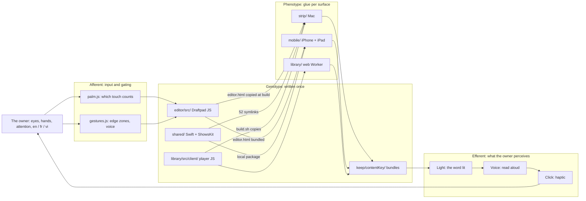

# Provisional Spec: Recense as one organism

Reference date: **2026-11-20**. This is the date every closing block cites (`docs/law/treaty.md`, Article 9).
It is a map, not a filing. It makes no claim of novelty.
Every analogy below names a real dependency and the file that proves it. An analogy without an edge was left out.

Read with: `docs/GENETIC-MAP.md` (where the copies are), `docs/law/treaty.md` (what binds), `docs/law/purpose.md` (what Recense is).
Proof labels as in the Map: **read**, **ran**, **inferred**, **untested**, **owner-stated**.

## 1 · The map

Edges and their proof:
- Editor to Mac: `strip/build.sh:47-48` copies `editor/dist/editor.html` into the app. **read**
- Editor to iOS: `mobile/HostApp/iOS/Draftpad.swift:171-172` loads the bundled page. **read**
- Shared to Mac: `strip/Sources/recense/` holds 52 entries and all are symlinks, 31 into `shared/`. **ran**
- Client to Mac: `strip/build.sh:37-43` copies six web modules at build time. **read**
- Bodies to `keep/`: `shared/carrysync.swift:291-317` carries `note.md` and `lines.json`. **read**
- Output order: `docs/law/interaction.md:42`, "the light leads, the sound follows, the click lands last". **read**
- Gating: `editor/src/palm.js:15` and `editor/src/palm.js:58-73` decide which contact reaches the ink layer; `editor/src/gestures.js:36-47` places the edge zones. **read**

## 2 · Biology

### Genotype and phenotype
- Genotype is the logic written once; phenotype is the glue that expresses it on one OS.
- Edge: `shared/` is compiled into the Mac by symlink and into iOS as a package. The 52 symlinks are the genome expressed in one body (above).
- Rule it serves: `docs/law/structure.md:47-48`, "One feature, one source".

### Mutation and drift
- A copy that stops being re-synced mutates. The Map counts them: zero byte-identical pairs, many drifted ones.
- Edge: `strip/editorhost.swift:481` asks for full calendar access; `mobile/HostApp/iOS/Draftpad.swift:335` asks for write-only. Same gene, two alleles, no one chose it.

### Horizontal transfer
- Code that moves sideways by copy at build time, not by inheritance.
- Edge: `strip/build.sh:37-43` copies web modules into the Mac app. It is safe when generated each build. It drifts when a hand copy is checked in: `strip/bridge/player-key.js:929` lacks `ctx` that `library/src/client/player-key.js:929-931` has. **read**

### Mutualism
- Two parties each gain from one improvement, with no cost to either.
- Edge: a better word-timing rule in `library/src/client/cadence.js` lights words on the web, and its Swift mirror lights them on the Mac and iOS. A shared fixture keeps both honest: `library/test/songlight.test.mjs:16-47`.
- This is the innovation incentive of the PCT in small: one filing, effect in each designated State. One cure, effect at every locus (Treaty Article 4).

### Habitat
- A shared substrate every organism lives on.
- Edge: `keep/<contentKey>/` is the common ground of Mac, iPhone, iPad and web. Three key spaces share the same 24-hex folder names (Map, C5), so the habitat is crowded; it needs a map of who may write where.

### Immune response
- A guard that refuses what would harm the host.
- Edge: `sync/src/ledger.mjs:84-90` (`massDelete`) and its exact twin `library/src/fp.js:64-65` refuse a mass delete. `shared/medianotefiles.swift:46-65` writes a conflict sibling instead of overwriting `note.md`.
- Autoimmune risk, the same system turned on itself: `mobile/HostApp/iOS/Listen.swift:544-545` deletes heard sentences permanently with no trash. Filed in the Map (C7), not fixed here.

## 3 · Philosophy

### One matter, many states
- One thing seen in different states, none the real one.
- Edge: `docs/law/purpose.md:10`, "Each carries the others' DNA"; `docs/law/purpose.md:14-44`, the principle. Draftpad as one matter: `docs/specs/FEAT-08-draftpad-one-matter.md:25`.

### The ship that keeps its planks
- A ship repaired plank by plank is still the ship, if no plank is thrown away.
- Edge: Treaty Article 8 (`docs/law/treaty.md:147-156`): governing documents are retrofitted, never deleted. Proof is the deletions column of `git diff --numstat`.

### Reciprocity
- A law that binds all parties equally is stronger than one that favours a few.
- Edge: Treaty Article 1(2) binds Claude, agy and Codex alike (`docs/law/treaty.md:53-76`). The limits that differ between them are measured, not assumed: `docs/AGENT-LIMITS.md`.

## 4 · Anesthesia and information flow

Anesthesia is controlled gating of signal between the body and awareness. Here the signal runs from the owner's hand to the owner's perception, and each stage can admit, delay or refuse it.

### Afferent gating
- A touch is admitted only if it is a hand, not a resting palm.
- Edge: `editor/src/palm.js:3-9` sets the thresholds (contact width 50, rest 300 ms). Its own comment says they are "assumed, not measured on the owner's devices". **untested** on device.

### Depth and titration
- Dose is raised in steps, not all at once.
- Edge: `docs/law/interaction.md:36-44` (haptics): at most three or four levels per dimension; a haptic never carries meaning alone.

### Sequencing the efferent signal
- The effect arrives in an order the patient can follow.
- Edge: `docs/law/interaction.md:42`: light, then sound, then click. The sync limit that keeps them together is in `docs/specs/FEAT-04-exact-time-sync.md:32` and `docs/specs/FEAT-20-prosody-on-ios.md:23`. No code constant implements it yet. **untested**

### Monitoring
- The vital signs are watched while the work goes on.
- Edge: each feature can write events to `~/Recense/logs/<feature>.jsonl` through the debug channel (`docs/specs/PARITY.md:17-28`, key `events:`).

## 5 · How enriching one feature enriches its dependents

- **Cadence** (`library/src/client/cadence.js`, `shared/ShowsKit/Sources/ShowsKit/Cadence/Cadence.swift`) feeds the web light, the iOS light (FEAT-20) and the Mac. A rule gained once lights every word everywhere.
- **ContentKey** (`shared/ShowsKit/Sources/ShowsKit/Model.swift:16-60`) names every `keep/` bundle. A key made right once keeps transcripts, notes and carry pointing at the same item.
- **Langs** (`shared/ShowsKit/Sources/ShowsKit/Langs.swift:7-22`) feeds the pickers, translation and speech. One list corrected reaches all three.
- **`Homes.remove`** (`shared/homes.swift:231-247`) is the only delete that can be restored. Every path routed through it gains that property.
- The cost of the opposite is the Map: each copy left alone costs one more place to cure.

## 6 · What this spec does not claim

- That any analogy is a proof. It is a way to read the dependencies, and each row can be checked against its file.
- That the biology is exact. A drifted twin is not literally an allele.
- That the PCT binds Recense. The parallel is structural (`docs/law/treaty.md`, opening).

---

## Appendix T · Treaty and Regulations: Articles, files and line ranges

Shape follows MPEP Appendix T, "Patent Cooperation Treaty and Regulations Under the PCT" (pages T-1 to T-4 read: title, adoption line, table of contents by Chapter, preamble, Articles with numbered paragraphs).
Done at `~/Developer/recense` on 2026-11-20.
Table of contents added for the reader; it is not part of the signed text.

Columns, written as lines: **Article**, what it governs, its text, the Rules and Instructions that carry it out, the files and lines that evidence it.
Every `path:start-end` can be checked with the command in `docs/law/instructions.md`, section 7.
Two sources are git-ignored and exist only in the main checkout: `.claude/CLAUDE.md` and `.handoff/`. They are named in words, not cited by line.

### Introductory Provisions

**Article 1 · Establishment of the Union**
- Governs: the jurisdictions, the acting entities, the order of authority.
- Text: `docs/law/treaty.md:53-76`
- Evidence: `docs/law/README.md:16-25`, `docs/law/structure.md:24-38`, `AGENTS.md:1-12`

**Article 2 · Definitions**
- Governs: genotype, phenotype, embodiment, twin, locus, cure, collapse, slice, the Map, the registry.
- Text: `docs/law/treaty.md:77-90`
- Evidence: `docs/GENETIC-MAP.md:14-31`

### Chapter I · Search and Cure

**Article 3 · The Search**
- Governs: what is read before any edit.
- Text: `docs/law/treaty.md:93-103`
- Rules: `docs/law/regulations.md:10-19`, `docs/law/regulations.md:39-49`
- Evidence: `docs/GENETIC-MAP.md:74-219`, `docs/specs/PARITY.md:17-28`, `sync/bin/triage-merge.zsh:202-222`

**Article 4 · Universal Effect of a Cure**
- Governs: one cure, every buildable locus, same commit; the unbuildable-twin exception.
- Text: `docs/law/treaty.md:104-117`
- Rules: `docs/law/regulations.md:39-49`
- Evidence: `docs/GENETIC-MAP.md:235-238`, `docs/specs/PARITY.md:17-28`, `sync/bin/coord.zsh:261-287`; the existing parity rule is `.claude/CLAUDE.md` lines 26-28 (local)

**Article 5 · Unity of Genotype and Reuse**
- Governs: reuse before new code; the net-gain test.
- Text: `docs/law/treaty.md:118-127`
- Evidence: `docs/law/structure.md:47-48`, `docs/GENETIC-MAP.md:220-234`

**Article 6 · Local Requirements**
- Governs: no surface imposes a form of its own.
- Text: `docs/law/treaty.md:128-133`
- Evidence: `docs/law/structure.md:47-48`, `docs/GENETIC-MAP.md:62-73`

**Article 7 · The Locus Declaration**
- Governs: what is printed before a file is modified.
- Text: `docs/law/treaty.md:134-144`
- Rules: `docs/law/regulations.md:20-27`
- Instructions: `docs/law/instructions.md:40-58`, `docs/law/instructions.md:78-197`

### Chapter II · Records

**Article 8 · Zero-Deletion Retrofit**
- Governs: governing documents are retrofitted, never deleted.
- Text: `docs/law/treaty.md:147-156`
- Instructions: `docs/law/instructions.md:217-224`
- Evidence: `docs/law/README.md:37-40`

**Article 9 · The Closing Duty**
- Governs: the closing block, the signature, the moat note.
- Text: `docs/law/treaty.md:157-172`
- Rules: `docs/law/regulations.md:91-94`, `docs/law/regulations.md:104-106`
- Instructions: `docs/law/instructions.md:59-77`

### Chapter III · Common Provisions

**Article 10 · Persistent Priorities**
- Governs: the five standing areas.
- Text: `docs/law/treaty.md:175-187`
- Evidence:
  - timing limits: `docs/specs/FEAT-04-exact-time-sync.md:32`, `docs/specs/FEAT-20-prosody-on-ios.md:23`
  - wish order: `docs/law/order.md:3-14`
  - languages: `docs/law/interaction.md:46-52`
  - storage: `shared/ShowsKit/Sources/ShowsKit/Model.swift:16-60`, `shared/carrysync.swift:291-317`
  - offline: `docs/law/offline.md:6-34`
  - Draftpad parity: `docs/GENETIC-MAP.md:78-97`
  - Map clusters for these areas: `docs/GENETIC-MAP.md:106-170`

**Article 11 · Effort and Elevation**
- Governs: the tiers and the gated words.
- Text: `docs/law/treaty.md:188-204`
- Rules: `docs/law/regulations.md:109-122`

**Article 12 · Ambidextrous Ergonomics**
- Governs: hand neutrality, bilateral placement, logical layout, input parity.
- Text: `docs/law/treaty.md:205-222`
- Evidence: `docs/law/interaction.md:27-31`, `editor/src/wings.js:529-571`, `editor/src/gestures.js:36-47`, `editor/src/palm.js:15`, `docs/GENETIC-MAP.md:199-219`

**Article 13 · Siblings**
- Governs: `blur` and `auditor`.
- Text: `docs/law/treaty.md:223-230`
- Evidence: `docs/GENETIC-MAP.md:48-61`

### Chapter IV · Administrative Provisions

**Article 14 · Regulations and Administrative Instructions**
- Governs: where the Rules and the Instructions live.
- Text: `docs/law/treaty.md:233-240`
- Rules: `docs/law/regulations.md:1-7`
- Instructions: `docs/law/instructions.md:1-6`

**Article 15 · Disputes**
- Governs: consensus, the holder's tie-break, the owner's reserved decisions.
- Text: `docs/law/treaty.md:241-248`
- Rules: `docs/law/regulations.md:50-57`
- Evidence: `sync/bin/coord.zsh:2-11`; the coordinator's rules are in `.handoff/coordinator/COORDINATOR.md` (local)

**Article 16 · Amendment**
- Governs: only the owner amends.
- Text: `docs/law/treaty.md:249-254`, `docs/law/treaty.md:259-261`
- Evidence: `docs/law/README.md:37-40`

**Article 17 · Entry into Force**
- Governs: when this takes effect.
- Text: `docs/law/treaty.md:255-258`
- Evidence: `docs/law/README.md:16-25`

### Regulations, by Part

- Part A · Intake: `docs/law/regulations.md:8-27`
- Part B · The five loops: `docs/law/regulations.md:28-71`
- Part C · Accounts, terminals, older forms: `docs/law/regulations.md:72-88`
- Part D · Closing and loose ends: `docs/law/regulations.md:89-106`
- Part E · Effort: `docs/law/regulations.md:107-122`
- Part F · Delegation: `docs/law/regulations.md:123-127`

## Amendments
- 2026-11-20 · created on the owner's approval of the plan (revision 2b).
